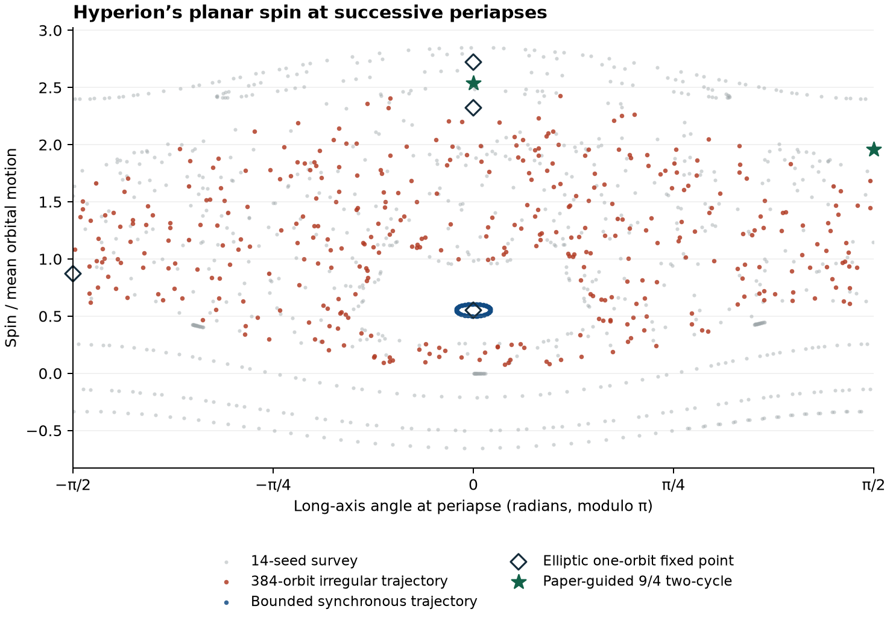

# Hyperion’s chaotic planar rotation

Wisdom, Peale & Mignard (1984), *The Chaotic Rotation of Hyperion*, Figure 2. The question is whether a rigid triaxial body on an eccentric Saturn-centered orbit exhibits a broad chaotic region alongside regular spin resonances. The native OEL periapse map reproduces that qualitative structure. The experiment covers planar spin with a fixed orbit. Three-dimensional tumbling, orbital evolution, and the state of the real moon are outside its scope. [Original paper, pp. 141–142](https://web.mit.edu/wisdom/www/hyperion.pdf)



Each dot is one periapse crossing. The two green stars belong to one two-orbit cycle. An island's spin at periapse can differ substantially from its mean spin over the orbit.

## Design and comparison

The initial survey used 14 combinations of angle and spin, followed by timestep refinement, local stability tests, and a 384-orbit trajectory with a 192-orbit half-step comparison. Winding counts full rotations. The dimensional scale was chosen for the simulation (semimajor axis 150,000 km) and both axes of the map are independent of that scale. The source figure and its resonance labels were withheld for the first analysis, although the analyst recognized the physical problem. The later search used three resonance labels from the paper.

## Planar spin–orbit dynamics at Saturn

We modeled a rigid triaxial satellite with principal moments A < B < C on a fixed point-mass Kepler orbit with eccentricity 0.1 and √[3(B−A)/C] = 0.89. The C axis was normal to the orbit, and monopole gravity-gradient torque was the only attitude torque. All trajectories and return maps came from the pinned native planetary orbit and passive attitude integration, not a separate integrator.

**Periapse section.** At each nominal orbital period, record the long-axis angle θ from the periapse direction modulo π and the instantaneous spin ω/n, where n is the mean motion. Radial-velocity zero crossings independently check the periapse timing. On this cylindrical section, crossings of its angular seam are not jumps in physical orientation. Winding is measured from the continuous angle in full turns per orbit; a one-return orbit can close modulo π after a half-integer number of full turns. We tested closure and estimated the planar return-map Jacobian by finite differences. The analytical expectation det ≈ 1 for the numerical map is an area-preservation check, not an independent trajectory calculation.

**Supported states.** The one-return search found linearly elliptic centers with winding 1/2 at (θ, ω/n) = (π/2, 0.871262), and winding 1, 2, and 5/2 at (0, 0.551537), (0, 2.322130), and (0, 2.721608). Both sampled 3/2 branches were hyperbolic, as was the sampled 3:1 branch at (π/2, 2.838459). The sampled −1, −1/2, and zero-winding branches were near marginal and left unclassified. A three-return solution near (0, 0) had winding 1/3 but was weakly hyperbolic (trace 2.00554); a seed averaging near 1/3 therefore does not establish a stable 1/3 island. Finite-window winding can also mislead: the (0, 1) seed looked synchronous over 64 orbits, but its later 48-orbit window in the 96-orbit run averaged about 1.159 turns per orbit.

**Integration and sampling sensitivity.** Halving the step preserved the reported one-return classifications and shifted the four elliptic periapse spins by less than 4×10⁻⁸. No periapses were reported missed; the event-timing comparison shifted the sampled time by about 6.7×10⁻⁸ s and θ by at most 2.7×10⁻⁹ rad. By contrast, two sensitive seeds had median coarse–fine section distances near 1.2 over the common tail. For (0, 1.5), four successive 96-orbit windows had finite-time growth of 0.81–1.00 per orbit and occupied 45–55 of 144 section cells each; two half-step windows gave 0.86–0.87 and 49–55 cells. Across both runs its sampled spin spanned about 0.078–2.451. These diagnostics support chaos over the sampled interval, not pointwise long-term reproducibility or convergence to a unique winding or invariant distribution.

The search does not exhaust periodic branches or resolve thin islands, near-marginal stability, or asymptotic transport. Ellipticity here is a linear planar result; neither nonlinear stability everywhere near a center nor stability to out-of-plane perturbations was established.

## Comparison after opening Figure 2

The paper shows a broad chaotic region enclosing the half-speed through double-speed states, with a prominent 9/4 island. The initial analysis recovered the broad irregular component, several regular centers and two hyperbolic 3/2 points. The published absence of a stable 3/2 island is consistent with the sampled branches. A finite search cannot establish absence throughout phase space. To test features beyond the initial search, the paper's 9/4, 3 and 7/2 labels were then supplied as targets. [Source figure and discussion](https://web.mit.edu/wisdom/www/hyperion.pdf)

Native OEL trials for the Figure 2 targets found one linearly elliptic $9/4$ cycle: the periapse state $(\theta\bmod\pi,\omega/n)$ alternated between approximately $(0,2.53656)$ and $(\pi/2,1.95934)$, advancing $9\pi$ over its fundamental two-orbit period. Two nearby trajectories stayed close for 16 orbits, which does not establish long-term stability. At both 3 and $7/2$ turns per orbit, the trials found one elliptic and one hyperbolic state, all with fundamental period one and net advances of $6\pi$ and $7\pi$ per orbit, respectively. Integration refinement preserved these classifications. The limited search found no fundamental two-orbit cycles at those latter windings but cannot rule them out.

An independent integration of the dimensionless planar Euler and Kepler equations checked the first return of each of the 14 production seeds. The largest discrepancies were 4.91 × 10⁻⁶ rad in orientation and 2.40 × 10⁻⁶ in normalized spin. A second installation built from the public-source export reproduced the five main batches, the multiple-return trials and the paper-guided search. The compact numerical results and comparison figure matched byte for byte on the same machine. The paper used 17 trajectories and 2,000 points in its largest chaotic region. This study used its own starting states and assessed finite-time behavior.

## Replay

The workspace locks OEL `1.2.0+preview.1` to the source revision in [oel-revision.lock.json](oel-revision.lock.json). The verified installation used CPython 3.12 on Apple Silicon, the public OEL Rust sources, and the OEL CPython 3.12 dependency constraints. Install Rust and Cargo first. From this study folder, use a fresh POSIX shell:

```sh
study_dir="$PWD"
python3.12 -m venv .venv
. .venv/bin/activate
python -m pip install 'maturin>=1.10,<2'
git clone --branch preview/hyperion-passive-attitude --single-branch https://github.com/adamcohen8/orbital-engineering-lab.git oel-source
git -C oel-source checkout --detach 76ad5422bb476dd6cd3e162fc6346b3f7af6c069
export OEL_SOURCE="$study_dir/oel-source"
python -m maturin build --release --locked --manifest-path "$OEL_SOURCE/rust/oel-orbit/Cargo.toml" --interpreter python --out "$study_dir/.wheels"
python -m maturin build --release --locked --manifest-path "$OEL_SOURCE/rust/oel-game/Cargo.toml" --interpreter python --out "$study_dir/.wheels"
python -m pip install -c "$OEL_SOURCE/constraints/py312.txt" "$study_dir"/.wheels/*.whl -e "$OEL_SOURCE" -r requirements.lock
for batch in production refine targeted long halfstep; do sh run-batch.sh "$batch" || exit 1; done
python multireturn.py
python paper_targets.py
python check_first_return.py
python summarize.py
python figure.py
```

The scientific runs are offline. Each batch writes to a fresh directory under `outputs/`. Reuse the original source and lock when resuming. The source-guided search has a configurable CPU limit and records whether it completed its design. On a slower computer, increase `--cpu-seconds` if needed. [results.json](results.json) records the numerical results for comparison. Rerunning `summarize.py` and `figure.py` regenerates that record and the figure. Chaotic trajectories on a different platform can diverge late in the run. Compare regular roots, windowed growth and section coverage across resolutions.

[configs/planar-saturn.yaml](configs/planar-saturn.yaml) is the validated orbit and inertia template from the long run. The driver sets the initial attitude and spin of each track at the initial periapse, then uses the native passive attitude and orbit propagators. The two panels generated inside each batch show periapse and apoapse separately. Only the periapse panel corresponds to Figure 2.
